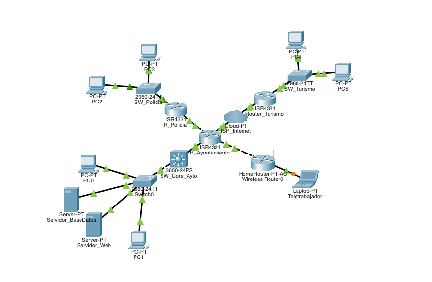

# AAD1_PabloRegidorGarcia

# SMART CITY

### AAD1 REDES AVANZADAS

Pablo Regidor García

1

<!-- Page 2 -->

# Tarea 1: Arquitectura WAN Inicial para la Smart City de Granada

### 1. Modelo de Red Seleccionado

El modelo empresarial seleccionado para el desarrollo de nuestro proyecto es el que conecta las LAN corporativas de la empresa, sus oficinas regionales y los trabajadores remotos mediante una red privada virtual. En este caso, la empresa se ha definido como el ayuntamiento de Granada, que consta de numerosas divisiones y departamentos interconectados mediante una red virtual privada. Se ha seleccionado este modelo para dar cabida a una gran cantidad de datos cuya privacidad debe protegerse, así como para conectar las diferentes oficinas y los servicios municipales más cruciales a través de una red metropolitana.

### 2. Necesidades de Conectividad

En lo que respecta a la conectividad, cuenta con importantes retos demográficos. Por lo tanto, el diseño de confidencialidad, integridad y disponibilidad debería considerar lo siguiente:

**Alta disponibilidad y baja latencia:**es necesaria para el sistema de emergencias, la gestión del tráfico (cámaras IP en tiempo real) y la consulta a los sistemas de la ciudad.

**La confidencialidad y la seguridad:**existe una obligación legal de proteger los datos personales de los ciudadanos y, por tanto, hay que diseñar una arquitectura que permita segmentar el tráfico administrativo y de los visitantes.

**Teletrabajo:**la red debe permitir a los funcionarios acceder de forma remota y cifrada a la información de sus departamentos, usar las aplicaciones

web de gestión del ayuntamiento y realizar llamadas VoIP.

2

<!-- Page 3 -->

### 3. Principales Redes, Usuarios y Servicios

Se ha definido una arquitectura jerárquica con las siguientes áreas de conexión, priorizadas por su nivel de importancia:

**Nodo Central:**Sede del ayuntamiento. Contiene el data center principal. Usuarios: administración local y departamento TI. Servicios:

Intranet, base de datos municipal, portal ciudadano y control de administración centralizado.

**Sucursal crítica:**jefatura de policía y movilidad. Usuarios: agentes y operadores. Servicios: centro de control de tráfico, videovigilancia y acceso a bases de datos de seguridad.

**Sucursales estándar:**oficinas de turismo. Usuarios: informadores turísticos y visitantes. Servicios: acceso a red administrativa básica y provisión de red inalámbrica pública aislada.

**Teletrabajadores:**funcionarios conectados remotamente. Servicios:

acceso cifrado a carpetas de departamentos y centralita VoIP.

### 4. Tecnologías WAN Consideradas y Justificación de la Solución

Para cubrir estas necesidades, se ha diseñado una topología híbrida tipo estrella Hub-and-Spoke utilizando tecnologías mixtas para optimizar el coste:

Enlace Principal (Ayuntamiento - Policía Local): Se evaluó el uso de líneas arrendadas tradicionales, pero debido a la criticidad de los datos policiales y el alto ancho de banda que requiere el streaming de vídeo de tráfico, se ha seleccionado la tecnología moderna Metro Ethernet (fibra óptica dedicada).

Conexiones de sucursales menores y teletrabajo: para las oficinas

de turismo y teletrabajadores, la alternativa seleccionada es el uso de

3

<!-- Page 4 -->

conexiones comerciales basadas en Internet mediante infraestructura de fibra óptica FTTx, con túneles VPN IPsec y de acceso remoto, terminados y filtrados en R_Ayuntamiento, que actúa como cortafuegos de la red.

Direccionamiento y escalabilidad: Se ha adoptado una estrategia de direccionamiento IPv4 de red privada 10.0.0.0/8. Esto evitará tener que volver a direccionar la red para admitir nuevos usuarios y facilita la escalabilidad ante futuros cambios de requisitos.

### 5. Topología física



4

<!-- Page 5 -->

# Tarea 2: Diseño del Modelo WAN

### 1. Tecnologías WAN Seleccionadas y Definición de Capas

Para la arquitectura, se han seleccionado dos tecnologías WAN complementarias: Metro Ethernet, para la conexión dedicada de la policía y conexiones de banda ancha FTTx sobre internet, con túneles VPN para las sedes periféricas y teletrabajadores.

**A) Enlace dedicado metropolitano (Metro Ethernet)** **Capa física:**el medio físico utilizado será el cable de fibra óptica, el cual es superior al cobre para transmisiones de media y larga distancia en áreas metropolitanas debido a su menor atenuación e interferencia.

El equipo de las instalaciones del cliente incluirá un router, equipado con módulos transceptores de fibra, insertados en sus interfaces.

**Capa de enlace:**el protocolo de la capa de enlace será Ethernet.

Metro Ethernet proporciona enlaces de gran ancho de banda que encapsulan los datos directamente en tramas Ethernet, lo que facilita la integración con las LAN Ethernet existentes en los edificios municipales, reduciendo los costos y el tiempo de instalación.

**B) Conexión basada en internet (Banda ancha FTTx y VPN)** **Capa física:**para el acceso al ISP, se utilizará infraestructura FTTx, donde el cable de fibra óptica llega hasta el límite del edificio. En el punto de demarcación del cliente, se ubicará un terminal de red óptica, que convierte la señal óptica en Ethernet, y que se conectará al router

del cliente mediante un cable de cobre de par trenzado.

5

<!-- Page 6 -->

**Capa de enlace:**para establecer la conexión inicial de banda ancha con el ISP, se utilizará el protocolo PPPoE, permitiendo al router actuar como cliente PPPoE para obtener su configuración IP pública de forma automática. Para garantizar la seguridad del tráfico corporativo a través de internet, se emplearán túneles VPN que aseguran la confidencialidad de los datos mediante algoritmos de cifrado como AES y autenticación mediante HMAC.

**C) Conmutación de paquetes** **Capa física:**En las conexiones que atraviesan el proveedor ISP hacia las sedes periféricas, el bucle local emplea fibra óptica o par trenzado de cobre GigabitEthernet conectado directamente a las interfaces integradas del router.

**Capa de enlace:**la conexión con las sedes que atraviesan el ISP, transporta tramas Ethernet de extremo a extremo, estableciendo la sesión inicial con PPPoE como en el resto de accesos de banda ancha.

Dentro de la red del operador, el tráfico puede viajar conmutado por etiquetas (MPLS).

**D) Conexión inalámbrica basada en internet (Acceso Wi-Fi en turismo** **y teletrabajo)** **Capa física:**utiliza las bandas de 2,4 GHz y 5 GHz. Este medio da soporte tanto a la red inalámbrica pública para visitantes en las oficinas de turismo como a la conexión inalámbrica del portátil hacia su equipo de accesoDSL.

**Capa de enlace:**el protocolo encargado de gestionar el acceso al medio radioeléctrico es Wi-Fi, mediante el mecanismo de prevención de

colisiones CSMA/CA y cifrado WPA2/WPA3 en el tramo local. Una vez

6

<!-- Page 7 -->

que las tramas llegan al equipo de acceso, se desencapsulan a Ethernet estándar y viajan protegidas hastaR_Ayuntamiento.

Una arquitectura convergente resiliente, habría unificado todo el tráfico municipal en un único transporte WAN redundante (por ejemplo, doble Metro Ethernet o MPLS con dos operadores). Se descarta por coste frente a la solución híbrida adoptada, que reserva la garantía de servicio solo para la policía y usa transporte comercial para el resto.

### 2. Listado de Equipos, Medios WAN y Presupuesto

### 1. Selección y Justificación de los Equipos de la Topología y Medios WAN

Todos los elementos seleccionados corresponden estrictamente a los nodos desplegados en el diseño lógico de Packet Tracer:

**Routers WAN de sede – *Cisco ISR 4331/K9 *:**Se utilizan tres unidades de este  dispositivo. El modeloISR 4331cuenta de serie con 3 puertos Gigabit Ethernet que admiten tanto cableado de cobre como módulos ópticos SFP. Su elección está justificada porque permite a R_Ayuntamientoactuar simultáneamente como concentrador del enlace directo Metro Ethernet haciaR_Policiay como terminador de los túneles VPN IPsec procedentes deRouter_Turismoy delTeletrabajo, aplicando políticas de filtrado mediante listas de control de acceso, sin necesidad de añadir dispositivos intermedios.

**Switch multicapa de núcleo – *Cisco Catalyst 3650-24PS *:**Situado

en el centro de datos del ayuntamiento. Gestionar el enrutamiento

7

<!-- Page 8 -->

interno entre las subredes del ayuntamiento a velocidad de hardware, sin saturar la interfaz LAN deR_Ayuntamiento, además de proporcionar alimentación eléctrica por cable para telefonía VoIP.

**Switches de capa de acceso – *Cisco Catalyst 2960-24TT *:** desplegados en todas las sedes. Disponen de 24 puertos FastEthernet para puestos de usuario y 2 puertos GigabitEthernet para el enlace hacia su respectivo router. Su elección se justifica por su fiabilidad para segmentar el tráfico local en VLANs y aislar los puertos de acceso.

**Servidores municipales y puestos:**alojan los servicios críticos, la base de datos de ciudadanos y el portal ciudadano/sede electrónica.

**Medios Físicos e Interfaces WAN empleadas:** *1.* ***Fibra óptica monomodo con módulos SFP:***Empleada en el enlace dedicado Metro Ethernet que une directamente R_AyuntamientoconR_Policia.

**Fibra FTTx / Enlace de banda ancha hacia ISP_Internet :** *2.* Utilizada para conectarR_Ayuntamiento,Router_TurismoyDSL a la red pública del proveedor.

*3.* **Cable de cobre de par trenzado UTP Categoría 6:**Utilizado en todas las conexiones LAN entre routers, switches, servidores y ordenadores.

Enlaces web de los equipos elegidos:

Router Cisco ISR 4331: https://www.cisco.com/c/en/us/support/routers/4331-

integrated-services-router/model.html

8

<!-- Page 9 -->

Switch Cisco Catalyst 3650-24PS: https://www.cisco.com/c/en/us/support/ switches/catalyst-3650-24ps-s-switch/model.html Switch Cisco Catalyst 2960-24TT: https://www.cisco.com/c/en/us/support/ switches/catalyst-2960-24tt-l-switch/model.html Módulos SFP de fibra: https://www.cisco.com/c/en/us/products/interfaces- modules/gigabit-ethernet-gbic-sfp-modules/index.html

### 2. Presupuesto de Implantación de la Arquitectura WAN

|El presupuesto contempla los elementos de la infraestructura de red de las|||||
|---|---|---|---|---|
|sedes, reflejadas en el esquema de Packet Tracer junto con el coste anual de las|||||
|líneas WAN contratadas:|||||
|Concepto/<br>Dispositivo en<br>topología<br>Concepto/<br>Dispositivo en<br>topología|Modelo/<br>Especificación|Cantidad|Precio unitario|Total|
|Routers WAN<br>(R_Ayuntamiento,<br>R_Policia,<br>Router_Turismo)|Cisco ISR 4331/K9<br>con licencia IPsec|3|2.620,00 €|7.860,00 €|
|Switch Core<br>Ayuntamiento<br>(SW_Core_Ayto)|Cisco Catalyst<br>3650-24PS|1|2.350,00 €|2.350,00 €|
|Switches de Acceso<br>(SW_Policia,<br>SW_Turismo)|Cisco Catalyst<br>2960-24TT-L|3|690,00 €|2.070,00 €|
|Módulos SFP Fibra<br>(Enlace<br>R_Ayuntamiento -<br>R_Policia)|Transceptor SFP<br>1000BASE-LX/LH|2|115,00 €|230,00 €|
|Servidores Centrales<br>(Servidor_BaseDatos,<br>Servidor_Web)|Servidor Rack<br>Empresarial para<br>CPD|2|1.950,00 €|3.900,00 €|
|Cableado e<br>Instalación|Fibra interior,<br>latiguillos UTP Cat 6<br>y configuración<br>lógica|1lote|2.400,00 €|2.400,00 €|

9

<!-- Page 10 -->

|Concepto/<br>Dispositivo en<br>topología|Modelo/<br>Especificación|Cantidad|Precio unitario|Total|
|---|---|---|---|---|
|Línea Metro Ethernet<br>Dedicada<br>(R_Ayuntamiento -<br>R_Policia)|Circuito fibra 1 Gbps<br>simétrico (12 meses)|1 año|300,00 €/mes|3.600,00 €|
|Líneas Banda Ancha<br>ISP_Internet<br>(Ayto.,<br>Turismo y Teletrabajo)|Accesos FTTx para<br>sedes y<br>teletrabajadores (12<br>meses)|1 año|650,00 €/mes|7.800,00 €|
|COSTE TOTAL DEL<br>PROYECTO INICIAL<br>(PRIMER AÑO)||||30.210,00 €|

### 3. Adaptación ante un Requisito Imprevisto:

### Proporcionar Red a un Nuevo Grupo de Usuarios

**3.1. Planteamiento del Escenario Imprevisto** Durante el desarrollo del proyecto, se plantea un cambio en los requisitos iniciales: el ayuntamiento necesita proporcionar una red independiente a un nuevo grupo de usuarios en la sede de las oficinas de turismo, garantizando que tengan acceso a Internet y alServidor_Webmunicipal, pero impidiendo por completo que puedan comunicarse con la red de la policía o con la base de datos del ayuntamiento.

**3.2. Análisis de Consecuencias sobre la Arquitectura Diseñada** Aplicar este nuevo requisito directamente sobre la topología actual conlleva tres consecuencias directas:

1. **Riesgo de seguridad por compartir la misma red local:**en la

topología inicial, los terminales conectados aSW_Turismocomparten un único

dominio de difusión. Si el nuevo grupo de usuarios se conecta sin segmentar la

10

<!-- Page 11 -->

red, tendría visibilidad directa sobre los ordenadores administrativos de la oficina y podría alcanzar elServidor_BaseDatosa través del túnel que une Router_TurismoconR_Ayuntamiento.

2. **Necesidad de subdividir el direccionamiento y crear puertas de**

**enlace lógicas:**comoRouter_Turismose une aSW_Turismomediante un único cable físico Ethernet, para dar una red distinta al nuevo grupo de usuarios sin añadir más routers es imprescindible dividir ese enlace físico en subinterfaces lógicas (*Router-on-a-Stick*).

3. **Filtrado de paquetes en el propio router:**Al no emplear un

cortafuegos dedicado externo, el control de acceso debe recaer íntegramente en el procesador del router mediante listas de control de acceso (ACLs) extendidas.

**3.3. Modificación y Justificación de la Solución sobre la Topología** **Actual** Aprovechando el direccionamiento privado planteado en la Tarea 1, y los propios equipos ya presentes en la topología, se realizan las siguientes adaptaciones:

1. **Definición de la nueva subred para el grupo de usuarios:**se

mantiene la subred para la LAN del ayuntamiento, la de la policía y la que esta dispuesta actualmente para los empleados de turismo y se crea la nueva subred exclusiva para el nuevo grupo de usuarios.

```
2. **Segmentación por VLANs en**SW_Turismo**y subinterfaces en**
```

**Router_Turismo :**En el switchSW_Turismose crean dos redes virtuales:

VLAN 10 y VLAN 20. Los puertos donde se conecta este nuevo grupo de

usuarios, se asignan en modo acceso a laVLAN 20, y el cable que sube

11

<!-- Page 12 -->

desdeSW_TurismohaciaRouter_Turismo,se configura como enlace troncal. EnRouter_Turismo,se crean dos subinterfaces lógicas, activando además un pool DHCP en el router para entregar IP automáticamente.

**3. Bloqueo de seguridad mediante ACL extendida en el router:**En una de las subinterfaces deRouter_Turismose aplica una ACL extendida, que evalúa cada paquete enviado por el nuevo grupo de usuarios:

Deniega cualquier paquete dirigido a la red de policía local.

Deniega cualquier paquete dirigido a la IP delServidor_BaseDatoso a los PCs internos del ayuntamiento y de la propia sede de Turismo.

Permite el acceso hacia elServidor_Weby haciaISP_Internet.

**4. Impacto en el diagrama y en el presupuesto:**Sobre el diagrama de Packet Tracer únicamente es necesario conectar los nuevos equipos del grupo de usuarios en los puertos de laVLAN 20deSW_Turismo. Al reutilizar las bocas libres del switch y las capacidades de VLAN y ACL del router, no es necesario comprar routers ni switches nuevos, requiriendo únicamente una partida de 450,00 € en concepto de tendido de latiguillos UTP adicionales, quedando el presupuesto final en 30.660€.

En caso de hacerla inalámbrica, sería necesario simplemente un AccessPoint-PT para permitir la conexión.

# Tarea 3: Reflexión Técnica sobre la Actividad

### 1. Elementos más Importantes y Principales

### Decisiones Adoptadas

12

<!-- Page 13 -->

**Arquitectura en estrella *Hub-and-Spoke *:**El elemento centra del diseño es el router del ayuntamiento,que centraliza tanto el enlace dedicado con la comisaría de policía como las conexiones a través de ISP_Internetcon las Oficinas de Turismo y el personal en remoto.

**Combinación de Metro Ethernet y FTTx + VPN:**Se decidió contratar una línea privada Metro Ethernet de fibra óptica únicamente entre R_AyuntamientoyR_Policiaporque el tráfico de videovigilancia y emergencias no tolera retardos ni congestión. En cambio, para unir Router_Turismose optó por enlaces comerciales de banda ancha sobre ISP_Internetprotegidos con túneles IPsec para reducir el coste.

**Uso de un switch de capa 3 en la sede central:**colocar un conmutador multicapa en la red del ayuntamiento, permite que el tráfico de alto volumen entre los ordenadores del Ayuntamiento y los servidores se conmute sin consumir recursos enR_Ayuntamiento.

### 2. Alternativa Arquitectónica si Cambiasen las Necesidades

Si las necesidades cambiasen, por ejemplo, si el volumen de cámaras de tráfico y llamadas VoIP exigiese que R_Policia y R_Turismo se comunicasen entre sí ,con alta disponibilidad, la topología actual en estrella resultaría limitada, ya que cualquier corte en el router central dejaría aislados ambas sedes.

En lugar de que R_Policia tenga un único cable hacia el ayuntamiento, se añadiría un segundo enlace hacia el ISP_Internet o con fibra a las demás sedes.

De esta forma, si falla el enlace directo, se redirigiría el tráfico a través de ISP_Internet, manteniendo el servicio activo en todo momento.

### 3. Ventajas y Desventajas de la Arquitectura WAN Diseñada

**Simplicidad:**

13

<!-- Page 14 -->

**Ventaja:**Al contar únicamente con tres routers, un switch de capa 3 y dos switches de acceso capa 2 en una topología en estrella, el mantenimiento y la depuración es ágil.

**Desventaja:**La gestión de seguridad recae en mantener actualizadas las ACLs y las VPN.

**Calidad:** **Ventaja:**El enlace directo Metro Ethernet entre entre la comisaría y el ayuntamiento, garantiza ancho de banda exclusivo y baja latencia.

**Desventaja:**Las conexiones de turismo y del teletrabajador dependen del ISP, donde el tráfico comparte infraestructura con otros clientes.

**Disponibilidad:** **Ventaja:**Los equipos seleccionados están diseñados para operar de forma ininterrumpida.

**Desventaja:**Existen puntos de fallo evidentes en la topología: cada sede depende de un único router y de un único cable WAN; si cae R_Ayuntamiento o se corta su enlace con el switch, se pierde el acceso a los servidores.

**Ancho de banda:** **Ventaja:**Las interfaces GigabitEthernet en los routers y el switch del ayuntamiento proporcionan suficiente ancho de banda

para datos, voz y vídeo.

14

<!-- Page 15 -->

**Desventaja:**El enlace entre los switches de acceso y los PCs finales trabaja en FastEthernet que es más lenta, y el cifrado añade trabajo de cabeceras en los paquetes que viajan por Internet.

**Seguridad:** **Ventaja:**El tráfico que cruza el ISP viaja cifrado mediante túneles VPN, y el tráfico interno del nuevo grupo de usuarios queda aislado mediante VLANs y ACLs extendidas en el router, protegiendo los servidores.

**Desventaja:**Al no disponer de equipos dedicados de inspección profunda de paquetes, el filtrado en los routers es limitado.

**Coste:** **Ventaja:**Es una solución muy barata, ya que aprovecha todas las funciones integradas en los routers y switches , además de solucionar el inconveniente, sin comprar hardware adicional.

**Desventaja:**El alquiler mensual del enlace dedicado Metro Ethernet supone un gasto recurrente fijo mayor que las líneas de banda ancha convencionales.

### 4. Aspectos Correctos, Aspectos Mejorables y Propuesta de Mejora Concreta

**Aspectos técnicos correctos:**la elección de tecnologías mixtas

adaptadas al rol de cada sede y el esquema de direccionamiento,que

15

<!-- Page 16 -->

permitió dar red al nuevo grupo de usuarios creando subredes y VLANs sin rediseñar.

**Aspectos mejorables:**Observando el diagrama lógico, el punto más débil es que no se repiten conexciones entre dispositivos:

**1.** Entre SW_Core_Ayto y R_Ayuntamiento solo hay un cable Ethernet; si ese puerto o cable falla, quedan desconectados los dos servidores centrales de toda la red.

**2.** R_Policia solo tiene un enlace hacia R_Ayuntamiento, sin salida alternativa de emergencia por ISP_Internet en caso de rotura de la fibra Metro Ethernet.

**Propuesta de mejora concreta sobre la topología:**Sin añadir dispositivos nuevos al esquema, se proponen dos mejoras directas aprovechando los puertos libres de los equipos actuales:

**1.** **Configurar un enlace agregado EtherChannel:**tendiendo un segundo cable GigabitEthernet entre SW_Core_Ayto  y SW_Ayto. Esto duplica el ancho de banda hacia los servidores centrales y tolerancia a fallo del acceso a servidores.

**Conectar la tercera interfaz libre de R_Policia al** **2.** **ISP_Internet**:configurando una ruta de respaldo a través de un túnel VPN, de modo que si se corta la conexión, vía Metro Ethernet,R_Policiamantiene la comunicación con R_Ayuntamientoa través deISP_Internet.

### 5. Reflexión sobre las Dificultades Encontradas y

### Decisiones Adoptadas

16

<!-- Page 17 -->

La principal dificultad encontrada durante la realización del proyecto, ha sido resolver el requisito imprevisto utilizando exclusivamente los routers y switches de la topología, sin comprometer la seguridad de los servidores ni la policía.

# 6.Bibliografía

**Guía oficial de la asignatura:**Cisco Networking Academy. CCNAv7:

Enterprise Networking, Security, and Automation Companion Guide. Cisco Press, 2020.

**Material de clase:**Apuntes y diapositivas de la asignatura.

**Catálogo de hardware de red:**Portal oficial de soporte y hojas de especificaciones de Cisco Systems:https://www.cisco.com

17
